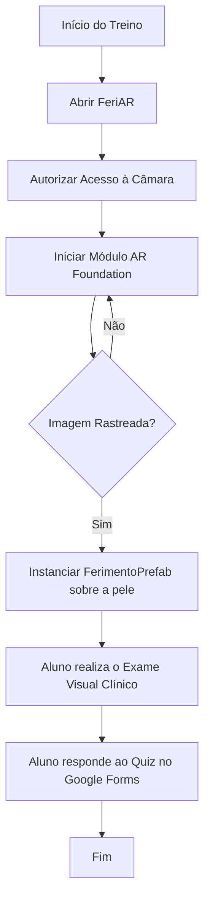

# FeriAR - Realidade Aumentada na Simulação de Ferimentos


---

## 1. Identificação do Projeto

| Item | Informação |
|---|---|
| **Projeto** | FeriAR |
| **Equipe** | Equipe FeriAR |
| **Curso** | Engenharia da Computação |
| **Disciplina** | UPX — Realidade Aumentada |
| **Professor** | Daniel Ohata |
| **Semestre** | 8º Semestre |

### Integrantes

| Nome | RA | Responsabilidade |
|---|---|---|
| Aliffer Leonn Pereira Azevedo | 235401 | Desenvolvimento da aplicação (Unity, AR Foundation, Image Tracking) |
| Kauã Vieira | 235388 | UX Design, Jornada do Usuário e Quiz de Validação |
| Kayke Vieira | 235390 | Pesquisa, Fundamentação Científica e Avaliação Clínica |
| Sebastião Gonçalves da Cunha Neto | 236106 | UX Design, Jornada do Usuário e Quiz de Validação |
| Victor Kenji Martins Umezu | 235289 | Pesquisa, Metodologia Científica e Protocolo Experimental |

---

## 2. Visão Geral

NECESSÁRIO REVISÃO URGENTE

A capacitação de estudantes de saúde para a avaliação de lesões exige vivência prática e visualização detalhada de características clínicas. O **FeriAR** é um aplicativo móvel de Realidade Aumentada (RA) projetado para renderizar modelos 3D de lesões cutâneas (como lesão por pressão e queimadura) diretamente sobre o corpo do utilizador. 

A solução resolve a dificuldade que os estudantes de Enfermagem possuem em identificar visualmente as características anatómicas das feridas utilizando apenas recursos 2D, sem depender de infraestruturas de alto custo (como manequins de alta fidelidade). A validação pedagógica do sistema utiliza um quiz externo para avaliar o desempenho imediato dos alunos após a visualização.


---

## 3. Problema

O ensino tradicional da avaliação de feridas na graduação de Enfermagem baseia-se fortemente em aulas teóricas com fotografias bidimensionais. As práticas imersivas exigem manequins de simulação ou projetores especializados de altíssimo custo. 

Essa limitação de recursos visuais dinâmicos dificulta o treino da observação clínica, impactando negativamente na capacidade do aluno em diferenciar texturas, bordas e cores de lesões reais, gerando insegurança antes do estágio prático em pacientes.

---

## 4. Objetivos

### 4.1 Objetivo Geral
Desenvolver e validar uma prova de conceito do aplicativo móvel FeriAR para avaliar o seu impacto no desempenho imediato de identificação visual de lesões e na usabilidade percebida por estudantes de Enfermagem.

### 4.2 Objetivos Técnicos
- Configurar um projeto Unity com suporte a Realidade Aumentada utilizando AR Foundation.
- Implementar o reconhecimento de marcadores (Image Tracking) através da câmara.
- Instanciar modelos 3D validados clinicamente (FerimentoPrefab) sobre a área rastreada.
- Realizar testes de estabilidade de rastreamento sob variações de iluminação e oclusão.
- Executar a aplicação num dispositivo móvel Android.

---

## 5. Público-Alvo

O público-alvo compreende estudantes regularmente matriculados no curso de graduação em Enfermagem que já tenham cursado a disciplina teórica de Fundamentos de Enfermagem. Estes possuem conhecimento prévio sobre a pele, mas necessitam de ferramentas interativas para treinar a observação visual antes das aulas práticas em laboratório.

A documentação complementar contendo a Persona e a Jornada do Utilizador está armazenada em `docs/documents/`.

---

## 6. Funcionalidades

| ID | Funcionalidade | Descrição | Status |
|---|---|---|---|
| RF01 | Iniciar câmara | Habilita a câmara traseira do dispositivo móvel para RA | ✅ |
| RF02 | Detectar marcador | Reconhece a imagem/marcador físico posicionado no corpo | 🚧 |
| RF03 | Renderizar lesão | Projeta o modelo 3D da lesão (FerimentoPrefab) ancorado ao marcador | 🚧 |
| RF04 | Validação Externa | Verificação do aprendizado clínico do aluno | ✅ |

**Legenda:** ✅ Implementado · 🚧 Em desenvolvimento · ⬜ Planeado · ❌ Cancelado

---

## 7. Requisitos Não Funcionais

| ID | Categoria | Requisito |
|---|---|---|
| RNF01 | Estabilidade | O modelo 3D deve manter o rastreamento estável sobre o marcador em caso de movimentos leves. |
| RNF02 | Desempenho | O aplicativo deve correr a uma taxa mínima de 30 FPS para evitar desconforto visual durante o exame clínico. |
| RNF03 | Iluminação | O sistema de detecção deve funcionar adequadamente sob condições de iluminação média a alta (luz de laboratório). |
| RNF04 | Independência | O aplicativo não deve exigir internet para projetar a RA (a conectividade é necessária apenas para o quiz externo). |

---

## 8. Tecnologias Utilizadas

| Tecnologia | Versão | Utilização |
|---|---|---|
| Unity | 6000.x | Motor de desenvolvimento principal |
| C# | Compatível | Programação de scripts da interface e controlo RA |
| AR Foundation | 5.x | Camada abstrata principal de integração de Realidade Aumentada |
| XR Interaction Toolkit | 3.5.1 | Framework de interações XR e controlo de câmara AR |
| Git | 2.x | Controlo de versão |
| GitHub | — | Hospedagem do código-fonte e documentação |
| Google Forms | — | Recolha de dados externos (Quiz Clínico e Escala SUS) |

---

## 9. Hardware Utilizado

| Equipamento | Modelo | Característica relevante | Utilização |
|---|---|---|---|
| Smartphone | Samsung Galaxy A55 | Android 14 / Câmara de alta resolução / Suporte ARCore | Execução, depuração e testes de estabilidade do app |
| Computador | Desktop Windows | CPU i7, 16GB RAM | Desenvolvimento da aplicação no Unity e processo de Build |

---

## 10. Arquitetura do Sistema

A arquitetura do FeriAR baseia-se no processamento da câmara do smartphone pelo framework AR Foundation, que identifica a imagem/marcador físico na pele e instancia o modelo 3D. A avaliação de conhecimento ocorre de forma desacoplada via web.


## Fluxo resumido
```text
Câmara do Dispositivo
   ↓
AR Foundation (Image Tracking)
   ↓
Identificação da Imagem de Referência
   ↓
Cálculo e Ancoragem Espacial
   ↓
Renderização do Ferimento (Modelo 3D)
   ↓
Visualização Clínica pelo Estudante
   ↓
Resposta no Quiz Externo (Google Forms)
```
---

## 11. Funcionamento da Realidade Aumentada

### 11.1 Técnica utilizada

O projeto utiliza a técnica de Image Tracking (rastreamento de imagem). Uma imagem impressa (banner.jpg ou ferimento.png) posicionada no corpo atua como referência plana para a projeção espacial.

### 11.2 Fluxo técnico


1. A aplicação inicia a sessão XR e ativa a câmara do dispositivo móvel.
2. O componente ARTrackedImageManager analisa continuamente os frames de vídeo capturados.
3. O algoritmo compara os pontos de contraste do ambiente físico com as imagens da biblioteca de referência.
4. Ao reconhecer o padrão do marcador na pele, o sistema calcula a sua posição e rotação (Transform).
5. O aplicativo instancia automaticamente o FerimentoPrefab.prefab na mesma posição do marcador, atrelando a geometria 3D da ferida ao movimento do membro do utilizador.

### 11.3 Elementos virtuais

VERIFICAR SE VAMOS MANTER ISSO
- modelo 3D;
- texto de orientação;
- destaque visual;
- botão de ação;
- indicação de status.

---

## 12. Estrutura do Projeto

```text
projeto/
│
├── Assets/
│   ├── Imagens/ (Materiais e marcadores como banner.jpg e ferimento.png)
│   ├── MobileARTemplateAssets/ (Scripts e UI base do framework XR)
│   ├── Prefabs/ (Contém o FerimentoPrefab.prefab)
│   └── SalaTeste.prefab (Cena principal de testes)
│
├── docs/
│   ├── diagrams/
│   ├── documents/
│   └── images/
│
├── .gitignore
└── README.md
```

### Pastas principais

| Pasta | Finalidade |
|---|---|
| `Assets/Prefabs` | Contém os modelos 3D das lesões (FerimentoPrefab) |
| `Assets/Imagens` | Armazena as referências de imagem (marcadores) e materiais de textura |
| `Assets/MobileARTemplateAssets/Scripts` | Scripts do XR Interaction Toolkit que gerem a UI |
| `docs/documents` | Arquivos de UX, Persona, Jornada do Utilizador e Termos Éticos |

---

## 13. Principais Scripts

| Script | Responsabilidade |
|---|---|
| `ARTrackedImageManager` | Componente nativo responsável por detetar marcadores 2D no ambiente. |
| `ARTemplateMenuManager.cs` | Gere as transições de interface de utilizador (UI) e menus do aplicativo. |
| `ARPlaneMeshVisualizerFader.cs` | Controla a renderização de malhas detetadas pela câmara. |
| `FerimentoPrefab` | Pré-fabricado 3D instanciado pela lógica de rastreamento. |

---

## 14. Dependências

Pacotes e frameworks necessários para o funcionamento pleno do projeto:

```text
XR Interaction Toolkit (3.5.1)   
AR Foundation (5.x)
Google ARCore XR PluginXR Plugin Management
```
---

## 15. Configuração do Ambiente

### Pré-requisitos:

- Windows 10 ou 11;
- Unity Hub;
- versão do Unity utilizada pela equipe;
- Android Build Support;
- Android SDK/NDK quando necessário;
- Git;
- dispositivo compatível com a tecnologia escolhida.

### Procedimento

1. Efetue o download e a instalação do Unity Hub.
2. Instale a versão Unity 6000.x (versão oficial de desenvolvimento da equipa).
3. Na etapa de módulos do Unity, marque obrigatoriamente a opção Android Build Support (com SDK e NDK).
4. Instale o Git.
5. Clone o repositório.
6. Abra o projeto pelo Unity Hub.
7. Aguarde a importação dos pacotes do XR Interaction Toolkit contidos na pasta Samples

---

## 16. Como Executar

Após concluir a configuração do ambiente:
Depois:

1. Com o projeto aberto no Unity, localize e abra o arquivo SalaTeste.prefab
2. Aceda ao menu superior e clique em File > Build Settings.
3. Verifique se a plataforma selecionada é Android (caso contrário, clique no botão Switch Platform).
4. Ative o modo de Programador e a Depuração USB no seu smartphone Android.
5. Ligue o dispositivo via cabo USB ao computador.
6. Clique no botão Build and Run. O Unity irá compilar o arquivo .apk e instalá-lo automaticamente no smartphone de teste.
---

## 17. Como Utilizar a Aplicação

1. Imprima a imagem do marcador de referência (banner.jpg ou ferimento.png localizado em Assets/Imagens/).
2. Posicione o marcador físico impresso.
3. Abra o aplicativo FeriAR no smartphone Android.
4. Conceda a permissão de uso da câmara solicitada pelo sistema.
5. Aponte a câmara para o marcador impresso.
6. O aplicativo irá reconhecer a imagem e sobrepor instantaneamente o modelo anatómico da lesão em Realidade Aumentada.
7. Ao finalizar a observação clínica, minimize o aplicativo e aceda ao link do Quiz Externo para registar o seu desempenho.

---

## 18. Fluxo de Funcionamento



---

## 19. Caso de Uso

O diagrama abaixo representa apenas um exemplo simplificado de interação.


---

## 20. Fluxo de Navegação

```text
Menu Principal da Aplicação
    ↓
Liberação de Permissões (Câmara)
    ↓
Ecrã de Escaneamento AR (A procurar Imagem)
    ↓
Visualização Interativa do Ferimento 3D
    ↓
(Fim do fluxo na app -> Transição para navegador)
    ↓
Avaliação Clínica (Forms)
```

---

## 21. Interface

As capturas de ecrã da experiência imersiva estão armazenadas em docs/images/.
---

## 22. Testes Técnicos

| Teste | Procedimento | Resultado esperado | Resultado obtido | Status |
|---|---|---|---|---|
| Inicialização AR | Abrir aplicativo no telemóvel | A câmara é ativada sem travagens | Funcionou | ✅ |
| Image Tracking | Apontar câmara para a imagem impressa | O XRTrackedImageManager deteta o padrão | Funcionou | ✅ |
| Oclusão e Perda | Cobrir o marcador com a mão | O modelo 3D desaparece ou pausa | Em validação | 🚧 |
| Projeção 3D | Detetar marcador com luz adequada | FerimentoPrefab é instanciado | Em validação | 🚧 |


---

## 23. Dispositivos Testados

| Dispositivo | Sistema | Versão | Resultado |
|---|---|---|---|
| Samsung Galaxy A55 | Android | 14 | Compatível (Tracking Estável) |

---

## 24. Limitações Conhecidas

- Perda de Rastreamento (Tracking Loss): O modelo 3D pode apresentar trepidação (jittering) ou desaparecer se a imagem de referência sofrer reflexos diretos de luz.
- Dependência Contínua: A geometria da ferida não fica fixa espacialmente sem a visão do marcador; se o estudante afastar a câmara da imagem impressa, a lesão desaparece.
- Fidelidade Clínica: A precisão das texturas depende da aprovação dos enfermeiros especialistas na fase prévia.

---

## 25. Evidências de Funcionamento

As fotos dos testes iniciais e as gravações de ecrã da projeção do FerimentoPrefab em laboratório estão disponíveis na pasta docs/images/.
(Em breve será adicionado o link do vídeo demonstrativo).

---

## 26. Repositórios e Recursos

| Recurso | Link |
|---|---|
| Código-fonte | https://github.com/alifferleonn/FeriAR |
| Figma | Inserir URL |
| Gestão Ágil e Tarefas (Trello) | https://trello.com/b/NABzhxGc/upx-8-los-peros-feriar |
| Vídeo | Inserir URL |
| Quiz Clínico e Avaliação SUS | [INSERIR_LINK_FORMS_AQUI] |

---

## 27. Cronograma Técnico

| Atividade | Responsável | Status |
|---|---|---|
| Pesquisa, Metodologia e Definição do Escopo | Victor e Kayke | ✅ |
| UX, Jornada do Usuário e Criação dos Questionários | Sebastião e Kaua | ✅ |
| Configuração do Repositório e Ambiente Unity | Aliffer | ✅ |
| Implementação da RA (Image Tracking e Modelos 3D) | Aliffer | 🚧 |
| Validação Clínica dos Modelos 3D | Equipe e Especialistas | ⬜ |
| Testes Técnicos e Execução do Experimento | Equipe | ⬜ |
| Documentação do GitHub (README) | Equipe | 🚧 |

---

## 28. Controle de Versão

O repositório utiliza o padrão Conventional Commits para registar o histórico técnico de desenvolvimento:

```text
feat: adição do FerimentoPrefab à cena principal
docs: atualização das instruções de uso e arquitetura no README
fix: correção de escala e alinhamento do modelo 3D sobre o marcador
test: registos de execução do apk no Samsung Galaxy A55
```

---

## 29. Problemas Encontrados e Soluções

### Problema 1 — Perda do Rastreamento por Brilho da Imagem

**Problema:** O modelo FerimentoPrefab desaparecia constantemente durante os testes iniciais sob a luz ambiente.
**Causa:** O reflexo das lâmpadas na superfície brilhante do marcador impresso ofuscava a câmara, impedindo a leitura dos pontos de ancoragem da imagem (banner.jpg).
**Solução:** Substituição do material de impressão do marcador por papel fosco, melhorando o contraste.

---

## 30. Melhorias Futuras

- Migrar a pesquisa para o rastreamento Markerless (Plane Detection) para permitir posicionar a ferida sem a necessidade de imprimir a imagem.
- Incluir oclusão avançada para que a curvatura do modelo respeite a curvatura anatómica (braço/perna) do paciente.
- Adicionar novos estágios da lesão por pressão ao banco de prefabs.

---

## 31. Custos e Recursos

| Recurso | Tipo | Custo/Condição |
|---|---|---|
| Unity | Software | Licença Educacional (Gratuito) |
| GitHub / Trello | Plataforma | Gratuito |
| Smartphone | Hardware | Equipamento da equipe |
| Computador | Hardware | Equipamento da equipe |

---

## 32. Licença

Projeto académico e científico desenvolvido para fins educacionais na disciplina de UPX — Realidade Aumentada.

---

## 33. Autores

- **Aliffer Leonn** — desenvolvimento RA
- **Kaua Vieira** — UX Design e Validação
- **Sebastião** — UX Design e Validação
- **Kayke Vieira** — Pesquisa
- **Victor Kenji** — Pesquisa e Metodologia

**Instituição:** UniFacens  
**Disciplina:** UPX — Realidade Aumentada  
**Semestre:** 2026.2

---

## Checklist de Entrega

- [X] Código-fonte atualizado

- [X] README completamente preenchido

- [X] Versões das tecnologias registadas

- [X] Arquitetura apresentada

- [X] Funcionamento da RA explicado

- [X] Estrutura de pastas documentada

- [X] Scripts principais descritos

- [X] Procedimento de instalação testado

- [X] Procedimento de execução testado

- [X] Screenshots reais adicionados

- [X] Testes registados

- [X] Dispositivos testados informados

- [X] Limitações conhecidas documentadas

- [X] Evidência de funcionamento adicionada

- [ ] Commits representam a evolução do projeto
